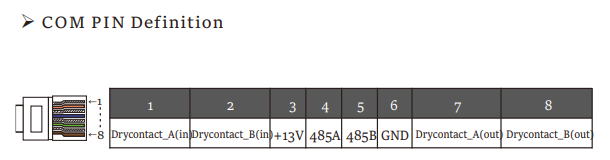
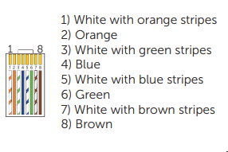
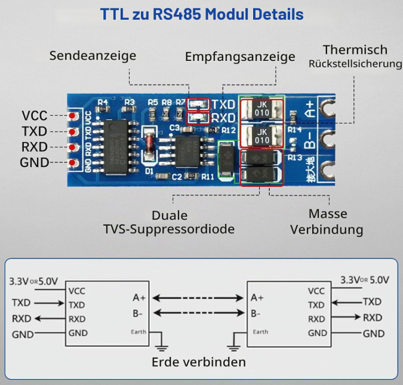
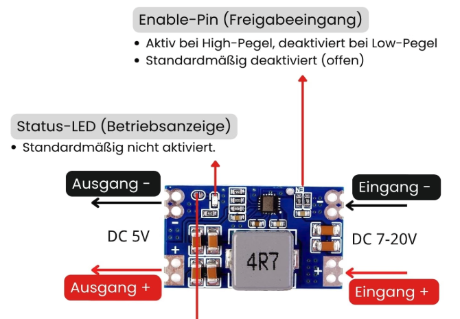

# Hardware description

## Parts list

| # | Part | Notes |
|---|------|-------|
| 1 | Raspberry Pi Pico W | Modbus TCP ↔ RTU bridge, WiFi uplink |
| 2 | Mini 560 DC-DC step-down, 5 V out | 18.3 × 30 × 5.5 mm; this unit is rated **DC 7–20 V input** (see [Mini-560 terminals](#mini-560-power-chain)), which covers the **measured** COM supply of 14.8 V (manual says +13 V nominal — it varies) |
| 3 | RS485-to-TTL adapter (auto-direction) | 16.6 × 42.8 × 3 mm; TX/RX LEDs, resettable fuses on A/B, TVS diode |
| 4 | Custom crimped RJ45 cable, 2 pairs | see [Cable pinout](#cable-pinout) |

## Device: Solax X3-Hybrid-G4 series

Installation manual: https://www.solaxpower.com/uploads/file/x3-hybrid-g4-installation-manual-en.pdf

### PIN definition for COM

Page 69 in the manual (72 of 90):




| 1                | 2                | 3           | 4    | 5          | 6     | 7                 | 8                 |
| ---------------- | ---------------- | ----------- | ---- | ---------- | ----- | ----------------- | ----------------- |
| Drycontact_A(in) | Drycontact_B(in) | +13V        | 485A | 485B       | GND   | Drycontact_A(out) | Drycontact_B(out) |
| orange/white     | orange           | green/white | blue | blue/white | green | brown/white       | brown             |

Colors follow standard T568B. Only pins 3, 4, 5 and 6 are used by this project.

> **Measured reality:** the manual labels pin 3 "+13V", but the actual output voltage
> varies between inverters. On the inverter used for this project it measured
> **14.8 V**. Treat the manual value as nominal only and design everything downstream
> (Mini-560 input range, wire insulation) for the measured voltage and some headroom
> above it.

**Safety (from the manual, page 69):**

- Pin 3 (+13V) is live whenever the inverter is powered (PV, battery or grid).
- Pin 3 and pin 6 must never be directly shorted to each other. The manual says to
  insulate the two pins when they are not needed — in this project they *are* needed,
  as the supply pair for the step-down converter. Take care while crimping that the
  green/white and green wires never touch before they are connected to the Mini-560.
- Pins 1, 2, 7, 8 (dry contacts) stay unconnected and may be left floating.

### RS485 to TTL Adapter



Adapter pin semantics (confirmed by the module's schematic and the Joy-IT COM-TTL-RS485
manual for this module type — note the direction convention is *not* symmetric):

| Terminal | Side   | Direction        | Meaning |
|----------|--------|------------------|---------|
| VCC      | TTL    | ← supply         | 3.3 V **or** 5.0 V (this project: 3.3 V) |
| TXD      | TTL    | **input**        | UART data from host into the adapter |
| RXD      | TTL    | **output**       | UART data from adapter out to host |
| GND      | TTL    | —                | TTL/logic ground |
| A+       | RS485  | ←→ differential  | RS485 non-inverted signal |
| B−       | RS485  | ←→ differential  | RS485 inverted signal |
| E        | RS485  | —                | RS485 ground potential ("Masse Verbindung") |

The adapter is an auto-direction type: no DE/RE flow-control pin is needed. The two
onboard LEDs (send/receive indicators) blink on bus activity — useful as a bring-up
signal.

## Wiring

### Signal flow, complete system

```
┌─────────────────────────┐
│ Solax X3-Hybrid G4      │        custom RJ45 cable (2 pairs)          device box
│ COM port (RJ45)         │
│                         │        wire          color
│ pin 3  +13V  ═══════════╪══════► green/white  ═════► Mini-560 IN+   (supply +)
│ pin 6  GND   ═══════════╪══╦═══► green         ──┬───► Mini-560 IN−   (supply −)
│ pin 4  485A  ═══════════╪══╪═══► blue          ═════► adapter A+    (RS485 data)
│ pin 5  485B  ═══════════╪══╪═══► blue/white    ═════► adapter B−    (RS485 data)
│                         │  ╚──────────────────────────► adapter E     (RS485 GND)
└─────────────────────────┘
```

Inside the device box the chains continue (see [Device box internals](#device-box-internals)):
Mini-560 OUT+/OUT− → Pico VSYS/GND, and Pico ↔ adapter over the TTL side.

### Mini-560 power chain

```
Solax COM pin 3 (+13V) ──► Mini-560 IN+
Solax COM pin 6 (GND)  ──► Mini-560 IN−

Mini-560 OUT+ (5 V)    ──► Pico W VSYS
Mini-560 OUT− (GND)    ──► Pico W GND

Pico W 3V3(OUT) (3.3V) ──► RS485 adapter VCC
Pico W GND             ──► RS485 adapter GND (TTL side)
```



Terminal names on the module (as marked in the picture): **Eingang +/−** = input
(DC 7–20 V, left/right marked "+"/"−"), **Ausgang +/−** = output (DC 5 V). Note two
special pads:

- **Enable pin (EN):** active high, *deactivated when open* — per the annotation the
  module is disabled by default. If OUT+ shows 0 V during bring-up, bridge EN to input
  "+" and re-measure.
- **Status LED:** indicates operation; not active by default, so a dark LED alone does
  not mean the board is dead.

VCC is deliberately 3.3 V, not 5 V: Pico GPIOs are not 5 V-tolerant, and the adapter's
RXD output drives Pico GP1 directly. At 3.3 V the logic levels stay in spec (the module
explicitly supports 3.3 V; Joy-IT's own example powers it from 3.3 V on Raspberry
hardware). The adapter draws only a few mA — no problem for the Pico's 3V3 regulator.

### Modbus data path

```
Solax COM pin 4 (485A) ──► adapter A+
Solax COM pin 5 (485B) ──► adapter B−
Solax COM pin 6 (GND)  ──► adapter E (RS485 ground)

Pico W GP0 (UART0 TX)  ──► adapter TXD   (TXD = data input on the adapter)
Pico W GP1 (UART0 RX)  ◄── adapter RXD   (RXD = data output on the adapter)
Pico W 3V3(OUT)        ──► adapter VCC
Pico W GND             ──► adapter GND
```

This matches the deployed firmware setting:
`UART(0, baudrate=19200, tx=Pin(0), rx=Pin(1), bits=8, parity=None, stop=1)` —
GP0/GP1 are **UART0** pins on the RP2040/RP2350 (UART1 lives on GP4/GP5 etc.,
so `UART(1, tx=Pin(0), ...)` fails with "bad TX pin"); 19200 8N1, Modbus RTU.
This does not clash with the REPL, which runs over USB CDC, not over UART0.

")

Pins used by this project (numbering from the picture):

| Pico pin | Board pin | Function in this project |
|---|---|---|
| GP0 | 1 | UART0 TX → adapter TXD |
| GP1 | 2 | UART0 RX ← adapter RXD |
| 3V3(OUT) | 36 | 3.3 V supply for the adapter |
| GND | 38 (or any GND) | common ground |
| VSYS | 39 | 5 V input from Mini-560 OUT+ |

The pinout picture also shows why GP0/GP1 are the natural choice: their primary
alternate function is already **UART0 TX/RX**, no GPIO-function configuration needed.

### Device box internals

```
┌───────────────────────────── device box ──────────────────────────────┐
│                                                                       │
│  Mini-560 5V step-down               Raspberry Pi Pico W              │
│  ┌────────────────────┐              ┌────────────────────────┐       │
│  │ IN+  ◄── +13V      │              │ VSYS ◄── Mini560 OUT+  │       │
│  │ IN−  ◄── GND       │              │ GND  ◄── Mini560 OUT−  │       │
│  │ OUT+ ──► Pico VSYS │              │ 3V3(OUT) ──► adapter   │       │
│  │ OUT− ──► Pico GND  │              │ GP0 (TX) ──► adapter   │       │
│  └────────────────────┘              │ GP1 (RX) ◄── adapter   │       │
│                                      │ GND      ──► adapter   │       │
│  RS485-to-TTL adapter                └────────────────────────┘       │
│  ┌────────────────────┐                                               │
│  │ VCC ◄── Pico 3V3   │  TTL side                                     │
│  │ TXD ◄── Pico GP0   │  (data input)                                 │
│  │ RXD ──► Pico GP1   │  (data output)                                │
│  │ GND ──► Pico GND   │                                               │
│  ├────────────────────┤                                               │
│  │ A+  ◄── 485A       │  RS485 side                                   │
│  │ B−  ◄── 485B       │                                               │
│  │ E   ◄── COM GND    │  (RS485 ground)                               │
│  └────────────────────┘                                               │
└───────────────────────────────────────────────────────────────────────┘
```

### Wire-by-wire connection table

| # | From | To | Wire / color | Purpose |
|---|------|----|--------------|---------|
| 1 | COM pin 3 (+13V) | Mini-560 IN+ | green/white | supply input |
| 2 | COM pin 6 (GND) | Mini-560 IN− | green | supply ground |
| 3 | COM pin 6 (GND) | adapter E | green | RS485 ground reference |
| 4 | COM pin 4 (485A) | adapter A+ | blue | RS485 non-inverted |
| 5 | COM pin 5 (485B) | adapter B− | blue/white | RS485 inverted |
| 6 | Mini-560 OUT+ | Pico VSYS | short lead | 5 V supply |
| 7 | Mini-560 OUT− | Pico GND | short lead | ground |
| 8 | Pico 3V3(OUT) | adapter VCC | short lead | 3.3 V adapter supply |
| 9 | Pico GP0 (UART0 TX) | adapter TXD | short lead | Pico → adapter data |
| 10 | Pico GP1 (UART0 RX) | adapter RXD | short lead | adapter → Pico data |
| 11 | Pico GND | adapter GND | short lead | TTL ground |

**Junctions (nodes with more than two connections):**

- **COM pin 6 (GND)** — one wire from the inverter, split at the device box to
  Mini-560 IN− **and** adapter E.
- **Pico GND** — receives Mini-560 OUT− and adapter GND.

All grounds end up on one net (inverter GND = adapter E = adapter TTL GND = Pico GND),
which gives the RS485 bus a common reference.

### Cable pinout

Custom RJ45, two pairs only, T568B colors, crimped on the inverter side; flying leads
into screw terminals / Mini-560 pads on the device-box side:

```
RJ45 pin  T568B color     COM signal          goes to
--------  --------------  ------------------  ----------------------------------
   3      green/white     +13V                ──► Mini-560 IN+
   4      blue            485A                ──► adapter A+
   5      blue/white      485B                ──► adapter B−
   6      green           GND                 ──► Mini-560 IN−  +  adapter E
   1      orange/white    Drycontact_A(in)    not used
   2      orange          Drycontact_B(in)    not used
   7      brown/white     Drycontact_A(out)   not used
   8      brown           Drycontact_B(out)   not used
```

The two used pairs are the factory twisted pairs: blue carries the RS485 data,
green carries the power. Pins 1, 2, 7, 8 are simply not wired.

## Bring-up notes and caveats

- **Bus termination:** the run is under 10 m at 19200 baud — start **without** a
  120 Ω resistor. If you see framing errors or echoes, add 120 Ω across A+/B− at the
  adapter end. The manual gives no termination guidance; the adapter has none built in.
- **Verify adapter ground continuity:** with a multimeter, check whether adapter `E`
  (RS485 GND) and adapter `GND` (TTL side) are internally connected. If they are not,
  the bus still works (RS485 is differential), but the common reference through the
  wiring above is the intended configuration.
- **If no Modbus response but the adapter's TX LED blinks:** the TXD/RXD convention
  could be reversed (other module variants label pins from the host's perspective).
  First swap the GP0/GP1 leads, then re-check. This project's adapter uses
  TXD = input / RXD = output as documented above.
- **Mini-560:** before first connection to the Pico, power it from the inverter,
  measure the input rail first (expect around 14.8 V on this unit — the "+13 V" label
  is nominal only and varies), then verify 5.0 V (± 5 %) on OUT+ with a multimeter.
  If OUT+ reads 0 V, pull the **EN pad** high (bridge it to input "+") — the module
  is disabled with EN open. Optionally add a small inline fuse (0.5 A) in the supply
  lead — the manual does not specify a current limit for COM pin 3.
- **Live pin:** COM pin 3 is live whenever the inverter is powered, even if the Pico is
  unplugged. Insulate the green/white lead whenever it is disconnected.
- **Not an Ethernet port:** the COM jack only accepts the pinout above — never plug it
  into a router or switch (manual warning).
- Plans/OVERVIEW gap **G12** (RS485 vs TTL assumption) is resolved by this document:
  the inverter side is RS485 half-duplex, bridged by the auto-direction adapter.
